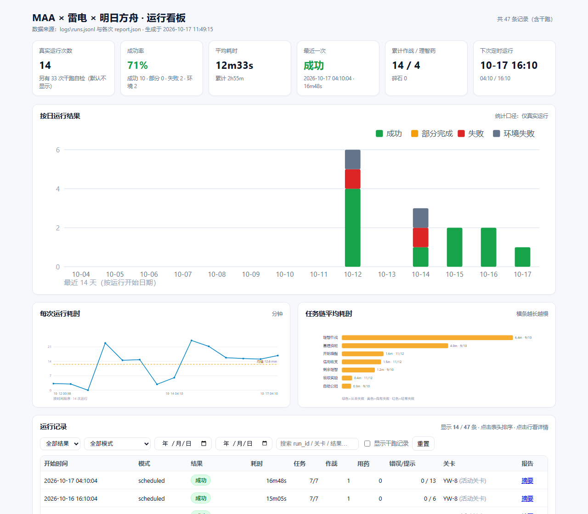

# MAA × 雷电模拟器 × 明日方舟 —— 自动挂机工程

**仓库**：<https://github.com/LIYuhao-u/maa-arknights-auto> ｜ **作者**：leo ｜ **首个版本**：v1.0.0（2026-10-18）｜ **许可证**：MIT

一份可以无人值守运行的明日方舟挂机方案：**定时唤醒电脑 → 启动雷电模拟器 → 拉起 MAA 执行任务队列（含「开始唤醒」= Link Start）→ 采集运行结果 → 退出模拟器 → 生成报告**。

驱动方式为 **MAA 官方 Python 接口（`asst.py` 直调 MaaCore）**，不依赖 MAA 图形界面、不模拟鼠标点击，因此锁屏也能跑，并且能拿到结构化结果（每个任务成败、掉落、公招、理智药/碎石消耗、错误原因）。

> **第一次用？五步（详见 §17）**
> ① 装 MAA（≥ v5.27）与雷电 9 → ② `Copy-Item config.example.json config.json` 并改其中 3 个路径 → ③ `.\run_now.ps1 -DryRun` 自检 → ④ `.\run_now.ps1` 真跑一次 → ⑤ `.\register_schedule.ps1` 开启定时。
> 作者与开发时间线见 **§18 / `AUTHORS.md`**。

---

## 0. 当前状态一览

| 项 | 值 |
|---|---|
| 工程根目录 | 仓库克隆位置（本机示例 `D:\maa-arknights-auto`；下文「工程目录」即指它） |
| 作者 / 许可 | **leo** &lt;1193725859@qq.com&gt; · MIT（见 §18、§19） |
| 计划任务 | `MAA-Arknights-Auto`，每天 **04:10 / 16:10** 触发，`WakeToRun` + 错过补跑 + 单实例 |
| 运行方式 | `pythonw.exe` 静默（无窗口），仅登录时运行 |
| 任务队列 | 7 项，直接读取 MAA 界面配置：开始唤醒 → 自动公招 → 基建换班 → 理智作战 → 剩余理智 → 信用收支 → 领取奖励 |
| 战斗关卡 | **跟随 MAA 界面**（本机当前 `YW-8`，SideStory「昨日海」，活动期至 **2026-10-23 03:59**） |
| 最近结果 | 2026-10-17 16:10 `scheduled` → `success`，耗时 14.8 分钟 |
| 历史统计 | 真实运行 14 次（成功 11 / 失败 2 / 环境错误 1），累计作战 15 次；另有干跑自检 40 次（默认不计入统计） |
| 报告总量 | `logs\` 下 54 个运行目录，约 44.5 MB（自动保留 60 天，**不入库**） |
| 可视化看板 | `dashboard\index.html`（零依赖单文件，双击即看；每次运行结束自动重建；产物不入库） |

> 上表是作者本机 **2026-10-18 00:31** 的实测快照，克隆到你机器上后数值自然会不同（用 `.\schedule_status.ps1` 看自己的）。

---

## 1. 工程位置与文件职责

```
工程目录\
├── config.example.json            ★ 配置模板：复制成 config.json 后改 3 个路径
├── config.json                    ★ 本机配置（不入库：含个人路径）
├── maa_runner.py                  ★ 主程序：自检 → 启模拟器 → 驱动 MAA → 采集结果 → 报告 → 收尾
├── maa_config.py                    配置加载 + 「MAA GUI 字段 → MaaCore 参数」映射 + 关卡有效性校验
├── _common.ps1                      ps1 公共函数（读配置、挑 Python 3.10+、修控制台编码）
├── run_now.ps1                      立即手动跑一次（`-DryRun` 干跑、`-KeepEmulator` 保留模拟器）
├── register_schedule.ps1            注册/更新计划任务（时间点来自 config.json）
├── unregister_schedule.ps1          取消计划任务
├── schedule_status.ps1              查看任务状态、下次/上次运行、最近结果、**配置漂移检测**
├── dashboard.ps1                    重建并打开可视化看板（`-Open` / `-NoBuild` / `-IncludeDryRun`）
├── make_shortcuts.ps1               生成/删除桌面一键入口（立即运行 / 打开看板 / 定时状态）
├── dashboard\
│   ├── build_dashboard.py           看板生成器（纯标准库、离线、单文件 HTML）
│   ├── index.html                   生成产物（不入库：含个人运行数据）
│   └── preview.png                  README 里用的看板截图
├── tests\
│   └── make_verify_config.py        生成「轻量全链路验证」用的任务清单与配置
├── logs\                           ← 所有运行产物都在这里（不入库，见第 6 节）
├── README.md                       本文件
├── AUTHORS.md                      作者、谁做了什么、开发时间线、AI 参与披露
├── CHANGELOG.md                    按真实日期记录的变更日志
├── LICENSE                         MIT
└── .gitignore / .gitattributes
```

> 这个工程**不修改 MAA 的程序与界面配置**（唯一例外见第 7 节），也不修改雷电的设置。任务是"旁路"驱动。

---

## 2. 系统架构与运行流程

### 2.1 调度链

```
Windows 计划任务 MAA-Arknights-Auto（04:10 / 16:10，WakeToRun）
        │
        ▼
pythonw.exe  maa_runner.py --config config.json --mode scheduled     ← 静默，无窗口
        │
        ├─ 1) 前置自检：MAA 目录 / MaaCore.dll / resource / Python 接口 / ldconsole / adb
        │      ├─ 刷新活动关卡数据（官方 OTA，TTL 6h，失败则用旧数据）
        │      ├─ 关卡有效性校验（官方活动接口 + 基础关卡表）
        │      └─ 加载 MaaCore 资源（主资源 + cache 增量资源）
        ├─ 2) 启动雷电实例 0（已在跑则跳过）→ 等 adb 就绪 → 等 sys.boot_completed
        ├─ 3) 校验客户端已安装（com.hypergryph.arknights）
        ├─ 4) 运行期间阻止系统空闲自动睡眠（SetThreadExecutionState）
        ├─ 5) 读取 MAA 界面配置 → 翻译成 MaaCore 任务 → 连接设备 → 依次提交并执行
        ├─ 6) 全程收集回调（任务成败/掉落/公招/消耗/错误）→ 写报告
        └─ 7) 收尾：停止 MAA → 退出模拟器 → 杀残留进程 → 清理过期报告 → 恢复电源策略
```

### 2.2 数据流（谁是事实来源）

```
MAA 界面 (config\gui.new.json)              任务队列 + 各任务参数
        │  ← 每次运行前现读，界面改了脚本自动跟随
        ▼
maa_config.py  build_queue()
        │   • 按 MAA GUI 源码规则换算成 MaaCore 参数
        │   • config.json 的 stage_overrides 可覆盖关卡（当前为空＝跟随界面）
        ▼
MaaCore.dll  AsstAppendTask(type, params) → AsstStart()
        │   • 官方回调：TaskChainStart/Completed/Error、StageDrops、RecruitResult…
        ▼
RunRecorder  →  report.json / summary.txt / callbacks.jsonl / maa-core-tail.log
```

**分工很清晰**：

| 你改什么 | 生效方式 |
|---|---|
| MAA 界面里的**任务队列与任务参数**（含战斗关卡） | 下次运行自动跟随，**不用改脚本、不用重新注册** |
| `config.json`（路径、时间、超时、是否覆盖关卡、收尾策略） | 运行时读取；**只有 `schedule.times` 需要重新注册才生效** |
| Windows 计划任务的时间点 | 由 `register_schedule.ps1` 写入，改配置后必须重跑它 |

---

## 3. 环境实况（本机实测）

| 组件 | 位置 / 版本 |
|---|---|
| MAA | `D:\program files\MAA-v5.15.3-win-x64\MAA-v5.27.1-win-x64`（外层目录名是历史遗留，实际生效 5.27.1） |
| MaaCore | **v6.18.0**（`MaaCore.dll`） |
| 雷电模拟器 | `D:\program files\leidian\LDPlayer9`，9.1.42，实例 0，1920×1080 |
| adb | 雷电自带 `LDPlayer9\adb.exe`，连接地址 `emulator-5554`，连接预设 `LDPlayer` |
| Python（计划任务用） | `pythonw.exe`（本机 3.13.2；MAA 接口要求 ≥ 3.10）；`_common.ps1` 会自动挑选 3.10+ 的 `pythonw.exe` |
| 游戏客户端 | `com.hypergryph.arknights`（官服） |

---

## 4. 日常使用（最常用命令）

在工程目录下执行（`cd` 到第 0 节的路径）：

| 我想… | 命令 |
|---|---|
| 看状态 + 最近几次结果 | `.\schedule_status.ps1` |
| 立刻手动跑一次（前台看日志） | `.\run_now.ps1` |
| 只做自检，不启动游戏 | `.\run_now.ps1 -DryRun` |
| 轻量全链路验证（真进游戏，只跑 3 个低消耗任务，约 3 分钟） | `python .\maa_runner.py --config .\config.verify.json --mode manual` |
| 跑完不关模拟器 | `.\run_now.ps1 -KeepEmulator` |
| 改触发时间 | 改 `config.json` 的 `schedule.times` → **必须** `.\register_schedule.ps1` |
| 打哪个关卡 | **在 MAA 界面里改**（脚本自动跟随）；要脚本层强制才用 `config.json` 的 `stage_overrides` |
| 改了 MAA 界面的任务设置 | 什么都不用做，下次运行自动生效 |
| 看最新一份报告 | `$d=(Get-Content .\logs\runs.jsonl -Encoding UTF8 \| Select-Object -Last 1 \| ConvertFrom-Json).dir; notepad "$d\summary.txt"` |
| **打开可视化看板** | `.\dashboard.ps1 -Open`（重建后打开；`-NoBuild` 只打开不重建） |
| **桌面一键入口** | `.\make_shortcuts.ps1`（创建 3 个桌面快捷方式）；`-Remove` 删除 |

### 4.1 config.json 关键项（改这里之前先看）

| 键 | 当前值 | 作用 |
|---|---|---|
| `maa.install_dir` | `D:\program files\MAA-v5.15.3-win-x64\MAA-v5.27.1-win-x64` | MAA 程序目录（含 `MaaCore.dll`）；**MAA 更新换目录后要改** |
| `maa.gui_config` | `config\gui.new.json` | 相对 `install_dir`；任务队列从这里读 |
| `maa.adb_path` / `adb_address` / `adb_config` | 雷电 `adb.exe` / `emulator-5554` / `LDPlayer` | 连接设置，与 MAA 界面「连接设置」一致 |
| `maa.touch_mode` | `minitouch` | 触控识别异常时改 `maatouch` 或 `adb` |
| `emulator.auto_launch` / `launch_wait_sec` / `boot_settle_sec` | `true` / `150` / `20` | 是否自动启模拟器、等待上限（秒）、启动后静置（秒） |
| `emulator.launch_retry` / `launch_retry_interval_sec` | `3` / `20` | 启动模拟器的重试次数与间隔（应对刚从合盖待机恢复时 `ldconsole launch` 假成功） |
| `emulator.quit_after_run` | `true` | 跑完是否退出模拟器 |
| `run.task_timeout_minutes` / `stall_timeout_minutes` | `300` / `25` | 单次总超时 / 多久没有任何回调就判定卡死并停止 |
| `run.prevent_sleep` | `true` | 运行期间阻止系统空闲自动睡眠 |
| `run.verify_stage` / `stage_activity_api` / `on_invalid_stage` | `true` / 官方活动接口 / `skip` | 关卡有效性校验；失效策略 `skip`（跳过并报警）/ `abort`（中止整次）/ `allow`（不拦） |
| `run.update_activity_cache` / `activity_cache_ttl_hours` | `true` / `6` | 自动刷新活动关卡导航数据（新活动开始时不必手动开 MAA 界面） |
| `tasks.source` | `gui` | 任务队列来源：`gui` = 读 MAA 界面配置 |
| `tasks.stage_overrides` | `{}` | **空 = 关卡跟随 MAA 界面**；要强制则写 `{"理智作战": "CE-6"}` |
| `tasks.skip_tasks` | `[]` | 按任务名跳过，例如 `["自动肉鸽"]` |
| `report.dir` / `keep_days` / `copy_maa_debug_log` | `logs` / `60` / `true` | 报告位置、保留天数、是否拷 MAA 核心日志 |
| `dashboard.enabled` / `dir` / `include_dry_run_by_default` / `max_runs` | `true` / `dashboard` / `false` / `500` | 运行结束后自动重建看板；统计口径与最多读取条数 |
| `schedule.task_name` / `times` / `wake_to_run` / `start_when_available` | `MAA-Arknights-Auto` / `04:10,16:10` / `true` / `true` | 计划任务设置；**改 `times` 后必须重跑 `register_schedule.ps1`** |

> ⚠️ **JSON 不支持 `//` 行内注释**：所有说明都写成 `_comment_*` 键（程序会自动忽略）。
> 改完 `config.json` 建议先 `.\run_now.ps1 -DryRun` 验证能正常解析并看到预期任务。

---

## 5. 开启 / 暂停 / 关闭 / 卸载

### 5.1 开启（注册定时）

```powershell
.\register_schedule.ps1                        # 按 config.json 的 times 注册（覆盖同名任务）
.\register_schedule.ps1 -Times '04:10','16:30' # 临时指定时间点，不改配置
```

### 5.2 临时暂停（保留配置，随时恢复）

```powershell
Disable-ScheduledTask -TaskName 'MAA-Arknights-Auto'   # 暂停定时（正在跑的那次不受影响）
Enable-ScheduledTask  -TaskName 'MAA-Arknights-Auto'   # 恢复
```

### 5.3 永久取消定时

```powershell
.\unregister_schedule.ps1        # 会问一次确认
.\unregister_schedule.ps1 -Yes   # 免确认
# 历史报告仍保留在 logs\ 里
```

### 5.4 打断正在进行的运行

```powershell
# 只结束本工程的运行进程（不影响其它 python 程序）
Get-CimInstance Win32_Process -Filter "Name='pythonw.exe'" |
  Where-Object { $_.CommandLine -like '*maa_runner.py*' } |
  ForEach-Object { Stop-Process -Id $_.ProcessId -Force }
# 顺手关掉模拟器
& 'D:\program files\leidian\LDPlayer9\ldconsole.exe' quit --index 0
```

强杀会让本次运行缺少收尾（报告里那次记录会停在"未结束"），下次触发照常执行。

### 5.5 A+ 一键入口（桌面快捷方式，不常驻进程）

```powershell
.\make_shortcuts.ps1           # 创建 3 个桌面快捷方式（幂等，可在改路径后重跑）
.\make_shortcuts.ps1 -Remove   # 删除这三个快捷方式
```

| 快捷方式 | 作用 |
|---|---|
| **MAA 立即运行** | 跑一次完整流程（弹控制台看进度，约 15~25 分钟） |
| **MAA 打开看板** | 重建并打开 `dashboard\index.html` |
| **MAA 定时状态** | 查看定时状态与最近结果（窗口保持不关） |

特点：**不常驻进程、不开端口、不需要管理员权限**。快捷方式内部用
`powershell.exe -NoProfile -ExecutionPolicy Bypass -File …`，不会受执行策略影响。
「立即运行」撞上正在进行的运行时会被单实例锁挡下（退出码 `12`），不会两个一起抢模拟器。

### 5.6 完全卸载本工程

```powershell
.\unregister_schedule.ps1 -Yes                              # 1) 取消计划任务
# 2) 删除工程目录（报告与脚本一起删掉）
Remove-Item '<工程目录>' -Recurse -Force
```

MAA 与雷电本体不受影响，可以继续单独使用。想连外部改动一起还原见第 7 节。

---

## 6. 报告与日志

所有产物都在工程内的 `logs\`，**每次运行一个目录**（目录名 = `YYYY-MM-DD_HHMMSS`）：

| 文件 | 内容 |
|---|---|
| `summary.txt` | **最常看**：人类可读报告（结果、任务明细、关卡校验、**关卡使用核对**、掉落、公招、消耗、提示/错误、产物列表） |
| `report.json` | 全部结构化数据（环境、preflight、任务数组（含每项作战场次）、stage_checks、**stage_usage**、skipped_tasks、掉落、公招、消耗、连接事件、错误、提示、警告） |
| `run.log` | 本次运行的完整过程日志（脚本自己的 INFO/WARN/ERROR） |
| `callbacks.jsonl` | MAA 原始回调流（逐条，事后可复查识别与决策过程） |
| `maa-core-tail.log` | MaaCore 本次新增的日志 |
| `maa-debug\debug\` | MAA 自己的调试数据：`asst.log` + 掉落识别截图 `drops\*.png` |
| `logs\runs.jsonl` | 索引：每次运行一行（结果/耗时/作战数/用药数/错误数/报告路径），`schedule_status.ps1` 读它 |
| `logs\.run.lock` | 单实例锁：存在即表示有运行在进行；异常残留（进程已死）会被自动接管 |
| `logs\lock-conflicts.log` | 被并发锁挡下的触发记录（不写报告、不进 runs.jsonl，避免污染统计） |

* 保留策略：`config.json` 的 `report.keep_days`（当前 **60 天**）自动清理过期目录。
* 省空间：把 `report.copy_maa_debug_log` 设为 `false`（不拷核心日志），或调小 `keep_days`。
* **关卡使用核对**：每次跑完会对比「配置的关卡」与「实际打到的关卡」（后者取自 `StageDrops` 回调的 `stageCode`）。配置了却一场没打成、或实际打到了别的关，都会进警告；关卡留空的任务会注明它打的是「上一次作战」的哪一关。

---

## 7. 本工程对外部做了什么改动

便于评估影响与"恢复原状"：

| 位置 | 改动 | 能否还原 |
|---|---|---|
| Windows 计划任务 | 新建 `MAA-Arknights-Auto` | `.\unregister_schedule.ps1` |
| `<MAA>\cache\resource\tasks.json` | 运行前自动刷新的**活动关卡导航数据**（官方 OTA），旧文件备份为 `tasks.json.bak` | 用 `.bak` 覆盖回去即可 |
| `<MAA>\debug\` | **不会写**（脚本把 MAA 的用户目录指向本次运行目录） | — |
| `<MAA>\config\gui.new.json` | **不会写**（其中的改动都是你在 MAA 界面里自己做的） | 由 MAA 界面管理 |
| 系统电源计划 | **未改动**（第 11 节给了可选命令，尚未执行） | — |
| `%TEMP%` | 命令输出用的临时文件，用完即删 | — |

---

## 8. 退出码与结论判定

| 退出码 | 含义 |
|---|---|
| `0` | 成功（全部任务链 completed） |
| `2` | 部分完成（有任务失败/未执行/因关卡失效被跳过） |
| `3` | 失败（一个任务都没完成，或被中断） |
| `4` | 环境自检失败（路径/资源/配置有问题，连模拟器都不会启动） |
| `5` | 超时或判定卡死（`task_timeout_minutes` / `stall_timeout_minutes`） |
| `9` | 未预期异常（崩溃不再伪装成成功） |
| `12` | **已有一次运行在进行**（单实例锁挡下，本次未启动任何东西） |

**"错误"与"提示"分开**：MAA 会把「信用商店买到没有信用」这类正常情况也报一条 `SubTaskError`，所以脚本区分——

* **错误（影响结论）**：核心异常、连接失败、任务链出错等，会让结论变成 `partial`/`failed`；
* **提示（不影响结论）**：可恢复的子任务报错、MAA 新版本写入的默认值字段等，只记录不判失败。

结论本身**以任务链实际状态为准**：全部完成＝成功；完成一部分＝部分完成；一个都没完成＝失败。

**关卡核对不改变结论，只报警告**：结论仍按任务链状态判定；但「配置 A、实际打 B」「配置了却一场没打成」会写进 `warnings`，在 `summary.txt` 的「关卡使用（配置 vs 实际）」章节、`run.log` 与看板详情里都能看到。这样做是为了让"任务链显示完成、但打的不是你要的关"这种情况不再静默。

---

## 9. 关键设计决策

| 决策 | 原因 |
|---|---|
| 用 Python 接口而非 MAA 自带定时器 | MAA GUI 的 Timer 只能跑任务、拿不到结构化结果还要常驻；接口方案能拿回调、锁屏也能跑 |
| 任务队列从 MAA 界面同步 | 避免"界面一套、脚本一套"的分叉；你在界面改完就生效 |
| 关卡默认跟随界面（`stage_overrides` 为空） | 换活动只需在界面改关卡；脚本层仍保留强制能力以备不时之需 |
| 运行前联网校验收关卡 | 活动关卡（如 YW-8）只存在于活动增量资源，活动一结束就会失效；校验能**在启动模拟器之前**拦下，而不是让 MAA 在关卡界面里瞎试 |
| 失效默认"跳过"而非"中止" | 跳过战斗任务可保住排在后面的信用收支、领取奖励；中止会连它们一起丢 |
| **不做**"关卡失效自动回落" | 静默换关卡＝打错图，是明确不想要的行为 |
| `user_dir` 指向本次运行目录 | MAA 的日志与调试截图按次归档，不污染 MAA 安装目录 |
| 运行期间阻止系统休眠 | 被唤醒后若又因"无操作"睡回去，模拟器与 adb 会一起断，任务半途而废 |
| 报告落盘后 `os._exit()` | MaaCore 是原生库，解释器收尾阶段卸载它可能崩溃并把真实退出码覆盖成 1 |

**映射规则的可信度来源**（`maa_config.py` 里的换算不是猜的）：

1. **MAA GUI 源码**（`MaaWpfGui` 的 `*SettingsUserControlModel.Serialize`）：决定"GUI 字段怎么算成 Core 参数"，例如公招 `3★ 只进 confirm`、`4/5/6★ 同时进 select+confirm` 且数组升序、`select/confirm` 无硬编码默认值。
2. **本机 `MaaCore.dll` 的字符串表**：决定"Core 到底认哪些键名"。据此纠正过 `level3_recruitment_permit_reserve`、`signinevent`、`medicine_expire_days`（替代已废弃的 `expiring_medicine`）、`skip_robot`（6.11 起废弃，改由 `preserve_tags` 承担）。

两者不一致或缺失时，脚本选择"不发送该参数 + 在报告里写出来"，而不是发一个可能被静默忽略的错误键。

---

## 10. 风险清单

### 必然会发生

| 风险 | 说明与应对 |
|---|---|
| **2026-10-23 03:59 活动「昨日海」结束** | YW-8 失效。脚本会在启动模拟器前拦下并跳过两个战斗任务（退出码 2），其余任务照常。**你要做的：10/23 之前（最后一次能打是 10/22 16:10）在 MAA 界面把两个战斗任务改成新活动关卡**，脚本自动跟随；活动导航数据脚本会自己刷新 |
| **合盖 = 待机 = 不会按点执行** | **2026-10-13 实测**：机器全天处于「新型待机（Modern Standby）」，04:10 与 16:10 两次触发**都没有执行**；直到 10/14 00:47:26 开盖退出待机，计划任务才在**同一秒**补跑一次（`StartWhenAvailable`），而那次补跑又因模拟器启动失败而以 `exit=4` 结束（已加重试修复）。**要让它按时执行：把「合上盖子时」设为「不采取任何操作」**（见第 11 节） |

### 可能发生

| 风险 | 应对 |
|---|---|
| MAA 组件自动更新换目录 | 脚本自动退化到同级最新目录并警告；顺手更新 `config.json` 的 `install_dir` |
| 网络不通 | 关卡校验查不到官方接口时，活动关卡会被判"无法确认"并**保守跳过**；想改成"查不到也照打"就设 `run.on_invalid_stage: allow` |
| 游戏/雷电大版本更新导致界面变化 | MAA 识别失败 → 报告里有连接/识别错误，`maa-debug\debug\` 有截图可排查 |
| 分辨率或触控方式变化 | 报告会出现 `UnsupportedResolution` / `TouchModeNotAvailable`，见第 12 节 |
| 账号多端在线 | 手机/别处同时玩可能干扰识别与代理指挥 |
| 理智药被大量消耗 | 这是 MAA 配置本身的效果（`MedicineCount: 999`）：每天 2 次会把理智药尽量打完。想留药就在 MAA 界面把上限调小 |
| 你勾上 MAA 的「周计划」 | 该功能在 MAA 界面侧换算，脚本无法复现 → 报告会明确警告。要么改用固定关卡，要么关掉 |

### 已消除

乱打关卡（运行前校验拦下）、跑一半被系统睡掉（`prevent_sleep`）、退出码被覆盖（`os._exit`）、"信用不足"被误判失败（错误/提示分离）、只跑脚本导致新活动关卡导航不了（OTA 自动刷新）、崩溃伪装成功（`unexpected`/退出码 9）。

---

## 11. 电源与睡眠（本机实测）

| 机器状态 | 到点会执行吗 | 原因 |
|---|---|---|
| 开机 + 已登录 + **不待机**（盖子开着或设为不操作） | ✅ | 这是唯一可靠按时执行的形态 |
| 合盖待机（Modern Standby，接电源） | ❌ **实测不会** | 10/13 全天合盖待机，两个触发点都没执行；`WakeToRun` + AC 唤醒定时器启用**也没能把它唤醒**（S0 机型行为与经典 S3 不同）→ 只有开盖时才补跑 |
| 睡眠（仅电池） | ❌ | DC 下唤醒定时器**禁用**，且 3 分钟无操作即睡 |
| 关机 / 注销 / 切用户 | ❌ | 关机＝彻底断电（S0 机型）；任务是"仅登录时运行" |
| 运行途中系统想睡 | 🛡 被挡住 | 脚本运行期间调用 `SetThreadExecutionState` 阻止空闲自动睡眠 |

**让合盖也能按时执行**（推荐，本机合盖动作设置没在 `powercfg` 里暴露，需走图形界面）：

> 控制面板 → 硬件和声音 → 电源选项 → 「选择关闭盖子的功能」→ 先点「更改当前不可用的设置」
> → 「合上盖子时」交流/电池都选**不采取任何操作** → 保存修改

（命令行方式需要**管理员**权限先解锁隐藏项：`powercfg -attributes SUB_BUTTONS 5ca83367-6e45-459f-a27b-476b1d01c936 -ATTRIB_HIDE`，
然后再 `powercfg /setacvalueindex SCHEME_CURRENT SUB_BUTTONS 5ca83367-6e45-459f-a27b-476b1d01c936 0` 并 `powercfg /S SCHEME_CURRENT`。
代价是合盖后机器不再省电，会一直全速运行——对挂机主机来说通常是想要的。）

其余可选电源设置（**尚未执行**，需要时自己在管理员 PowerShell 里跑）：

```powershell
powercfg /SETDCVALUEINDEX SCHEME_CURRENT SUB_SLEEP RTCWAKE 1        # 电池下也允许唤醒定时器
powercfg /SETDCVALUEINDEX SCHEME_CURRENT SUB_SLEEP STANDBYIDLE 1800 # 电池下改成 30 分钟才睡
powercfg /SETACVALUEINDEX SCHEME_CURRENT SUB_SLEEP STANDBYIDLE 1800 # 接电源时跑完 30 分钟自动回睡
powercfg /S SCHEME_CURRENT
```

---

## 12. 排查手册

| 现象 | 处理 |
|---|---|
| **改了 `config.json` 的时间但没按新时间跑** | 时间点只在注册时写入计划任务：改完必须再跑 `.\register_schedule.ps1`。`.\schedule_status.ps1` 现在会红字报出这种"配置漂移" |
| 计划任务上次结果 `4` | 环境自检失败，通常是 MAA 路径变了或配置文件坏了 |
| 提示「已有一次运行在进行」（退出码 `12`） | 正常保护：等当前那次跑完再点。确实怀疑卡死时，确认没有 `pythonw` 在跑后删掉 `logs\.run.lock`，或用 `python maa_runner.py --ignore-lock`（不建议） |
| 报告里 `缺少MAA 安装目录 / MaaCore.dll` | 更新 `config.json` 的 `maa.install_dir` |
| `ConnectFailed` | 模拟器没起来或端口不对；手动开一次雷电，确认 MAA 界面用 `emulator-5554` 能连上 |
| `UnsupportedResolution` | 雷电分辨率改成 1280×720 或 1920×1080，DPI ≤ 320 |
| `TouchModeNotAvailable` | `maa.touch_mode` 从 `minitouch` 改成 `maatouch` 或 `adb` |
| `MAA 已 N 分钟没有任何回调，判定卡死` | 游戏卡在登录/断网；看 `logs\<run_id>\maa-debug\debug\` 的截图 |
| `模拟器里没找到客户端` | 该实例没装官服客户端（或装了 B 服，需改客户端类型） |
| `关卡 X 不可用：活动…已结束` | 到 MAA 界面把战斗关卡改成当前活动关卡（脚本自动跟随） |
| 公招"只识别一次就不动了" | 识别到 5★/6★ 而你还未允许自动确认，MAA 按设计停手等你手动处理；要自动就在 MAA 界面勾上对应星级 |
| 报告出现"未映射字段（非默认值）"警告 | 你在 MAA 界面开了脚本复现不了的功能（如「周计划」） |
| 报告出现"未映射字段（默认值）"提示 | 只是 MAA 新版写入的默认字段，无影响，忽略即可 |

---

## 13. 已知限制与未验证项

诚实列出，避免误以为"全都验证过"：

1. **「周计划」（`UseWeeklySchedule`）无法复现**：它是 MAA 界面侧的概念（界面自己把周计划换算成具体关卡/排班），MaaCore 没有对应参数。取值非默认时报告会明确警告。当前该开关为关闭。
2. **"MAA 任务链失败会中断后续任务"是推断，未实测**：因为关卡校验会把这种情形提前拦下，实际不会走到那一步；也正是为此把失效策略设成"跳过"。
3. **锁屏状态未实测完整运行**：MAA 走 adb 截图+点击，理论上不受锁屏影响；但**合盖待机已实测会导致漏跑**（见第 11 节），这两件事要分开看。
4. **"长时间连续挂机数小时"未专门压测**：定时运行单次约 15~23 分钟（含 3 次作战的那次 1374 秒）已跑通。
5. **未经历真实的"活动切换"**：10/23 的"拦下 → 改关卡 → 恢复"是按设计推演，并用假关卡（已结束活动的 `AT-8`、不存在的 `ZZ-9`）验证过拦截逻辑，真实切换待 10/23 检验。
6. **关卡校验只管"名字有效"，不管"实际打到"**：运行前只能确认关卡名在 MAA 数据里有效（活动没过期），MAA 真正进哪一关由运行期导航决定。所以 10/25 起跑完会做一次**事后核对**（`StageDrops` 的 `stageCode` vs 配置关卡），不一致只报警告，不改变结论。
7. **只看得到"识别到掉落结算"的那几场**：`StageDrops` 不是每场都发（实测 7 场作战里只有 2 次结算回调），所以"实际关卡"是按有结算的那几场判断的；一场结算都没有时，状态显示为「无法核对」而不是「一致」。

---

## 14. 变更记录（重要修复）

| 时间 | 事件 |
|---|---|
| 10/12 00:50 | 首次注册计划任务（04:10 / 12:10 / 20:10） |
| 10/12 00:38 / 00:43 | 两次轻量全链路实测：链路通，但暴露 ① 退出码被解释器收尾覆盖成 1 ② "信用不足"被判成失败 → 均已修 |
| 10/12 04:10 / 12:10 / 20:10 | 三次定时运行全部成功（7/7），掉落关卡记录为 `YW-8` |
| 10/12 深夜 | 新增：运行前关卡校验（skip/abort/allow）、活动数据 OTA 自动刷新、提示/警告分级 |
| 10/13 00:51 | 你把 `config.json` 时间改成 04:10 / 16:10（**未重新注册 → 未生效**） |
| 10/13 01:03 | 你在 MAA 界面把公招 5★ 勾上（脚本已自动跟随：`select=[4,5]`、`confirm=[3,4,5]`） |
| 10/13 01:07 | 按你要求**取消关卡强制**，改回跟随 MAA 界面；重新注册计划任务（04:10 / 16:10 生效） |
| 10/13 01:08 | 修复两个自身缺陷：`build_queue` 三元组改动半途（会 `NameError`）、**崩溃被 dry-run 结论掩盖成 exit=0**（现为 `unexpected`/9） |
| 10/13 全天 | **两次定时（04:10 / 16:10）都没执行** —— 机器全天处于合盖待机（Modern Standby），事件日志只有几秒钟的自动维护唤醒 |
| 10/14 00:47 | 开盖退出待机 → 计划任务**同一秒**补跑（StartWhenAvailable），但 `ldconsole launch` 假成功、模拟器没起来 → `exit=4`；实测同一台机器在**清醒状态**下 5 秒即可启动，确认失败只发生在"刚退出待机"那一刻 |
| 10/14 00:55 | 新增**模拟器启动重试**（`emulator.launch_retry=3`，失败先 quit + 杀残留再重来），并纠正 README 里"接电源睡眠会被唤醒"的错误结论 |
| 10/17 12:00 | 新增**跨进程单实例锁**（`logs\.run.lock`，退出码 `12`）：定时触发与手动触发不会再互相抢模拟器；被挡下的触发不写报告、只记 `lock-conflicts.log`；坏锁/残留锁有接管逻辑 |
| 10/17 12:12 | 新增 **A+ 一键入口**：`make_shortcuts.ps1` 生成 3 个桌面快捷方式（立即运行 / 打开看板 / 定时状态），不常驻进程、不开端口；看板页脚增加并发冲突统计 |
| 10/17 11:47 | 新增**可视化看板** `dashboard\index.html`（零依赖单文件）：KPI、按日柱图、耗时折线、任务耗时条形、可筛选记录表、单次详情、定时与配置健康面板；每次运行结束自动重建 |
| 10/24 04:10 / 16:10 | **打错关卡的真实事故**：`理智作战` 配 `CA-5` 却 51 秒就失败（导航到 CA-5 时 OCR 连续 20 次全空），`剩余理智` 关卡为空 → MAA 点「前往上一次作战」→ **两次分别打了 7 场 / 6 场 `AD-8`**（21 理智/场，理智 156→12）。根因是「空关卡 = 打上次作战」这个洞，叠加那两次的导航失败。AD-8 不在 MAA 任何数据里，只能来自游戏里上一次作战 |
| 10/25 14:10 | 新增**关卡使用核对**：`StageDrops` 回调现在带上 `taskid`，运行结束逐任务对比「配置 vs 实际」——配置了没打成 / 打到别的关 → 警告；空关卡任务 → 提示它实际打的是哪一关；任务条目增加 `battles`（每项作战场次）。用 3 次历史运行的回调回放验证，结果与历史报告完全一致 |

---

## 15. 可视化看板

零依赖、离线、单文件的静态看板，双击即可看，**不需要启动任何服务**：



```powershell
.\dashboard.ps1 -Open            # 重建并用默认浏览器打开
.\dashboard.ps1                  # 只重建，打印路径
.\dashboard.ps1 -NoBuild -Open   # 直接打开现有看板（数据可能不是最新）
.\dashboard.ps1 -IncludeDryRun   # 图表口径也包含 dry-run 自检
```

**页面内容**

| 区域 | 说明 |
|---|---|
| KPI 卡 | 真实运行次数、成功率、平均耗时、最近一次（时间·结果·耗时）、累计作战/理智药/碎石、下次定时运行 |
| 按日运行结果 | 近 14 天堆叠柱（成功 / 部分完成 / 失败 / 环境失败） |
| 每次运行耗时 | 时间序折线 + 均值参考线（分钟） |
| 任务链平均耗时 | 横向条形，右侧标 `平均耗时 · 成功/总次数`；颜色＝从未失败 / 偶有失败 / 经常失败 |
| 运行记录 | 可排序、按结果/模式/日期/关键字筛选，**默认隐藏干跑自检**；点行展开单次详情 |
| 单次详情 | 每个任务的耗时与状态条、错误与提示（超过 6 条折叠）、掉落明细、四个产物链接（摘要 / 报告 JSON / 运行日志 / 原始回调） |
| 定时与配置 | 计划任务状态、注册触发、下次/上次运行与结果码、**配置漂移红字**、任务来源/关卡/校验/防休眠等摘要 |
| 错误与提示归因 | 按出现次数排序；「提示」不影响运行结论 |
| 页脚 | 生成时间、记录是否被截断/解析失败数、**并发冲突次数**（见 `logs\lock-conflicts.log`） |

**数据与刷新**

- 数据源：`logs\runs.jsonl`（聚合）+ 每次运行的 `report.json`（明细）+ `config.json` + 本机计划任务
- **每次运行结束自动重建**（`dashboard.enabled=true`，失败只记警告、不影响运行结论）
- 静态页面：刷新浏览器不会更新数据，**重建后再刷新**才是最新
- 默认统计口径与表格都排除 `dry-run`（`-IncludeDryRun` / 配置可切换）
- 直达某次运行：`index.html#run=<run_id>`

**已知限制**

- 计划任务信息来自本机 `Get-ScheduledTask`，约 2 秒开销（`--no-task-query` 可跳过）
- 只读最近 `dashboard.max_runs`（默认 500）条记录，超出部分在页脚注明
- 不做浏览器自动刷新，也不含任何操作按钮——操作仍走 PowerShell 命令（页脚有提示）

---

## 16. 速查卡

```powershell
cd <工程目录>

.\schedule_status.ps1                 # 状态 + 漂移检测 + 最近结果
.\run_now.ps1 -DryRun                 # 自检（不启动游戏）
.\run_now.ps1                         # 立刻跑一次
.\register_schedule.ps1               # 改完时间后必须执行
.\dashboard.ps1 -Open                # 打开可视化看板（重建后打开）
.\make_shortcuts.ps1                 # 生成桌面一键入口（立即运行/看板/状态）
Disable-ScheduledTask -TaskName 'MAA-Arknights-Auto'   # 临时暂停
Enable-ScheduledTask  -TaskName 'MAA-Arknights-Auto'   # 恢复
.\unregister_schedule.ps1             # 取消定时

# 看最新报告
$d = (Get-Content .\logs\runs.jsonl -Encoding UTF8 | Select-Object -Last 1 | ConvertFrom-Json).dir
notepad "$d\summary.txt"
```

三句话记住这个工程：

1. **任务怎么配** → 在 MAA 界面配，脚本每次运行现读，改完即生效。
2. **什么时候跑** → 在 `config.json` 里改时间，**然后必须** `.\register_schedule.ps1`。
3. **结果在哪** → `logs\<日期_时间>\summary.txt`，索引在 `logs\runs.jsonl`。

---

## 17. 从零部署（新机器 / 新克隆）

| 步骤 | 命令 / 操作 | 通过标准 |
|---|---|---|
| 1. 依赖 | 安装 **MAA ≥ v5.27**（官方安装包即可，本工程只调用其 `Python\asst.py` 与 `MaaCore.dll`）、**雷电模拟器 9**（装官服《明日方舟》，分辨率 1920×1080）、**Python ≥ 3.10** | `python --version` 有输出 |
| 2. 取代码 | `git clone https://github.com/LIYuhao-u/maa-arknights-auto.git` → `cd maa-arknights-auto` | 目录里有 `maa_runner.py` |
| 3. 配路径 | `Copy-Item config.example.json config.json`，只改这 3 个键：`maa.install_dir`、`maa.adb_path`、`emulator.ldconsole` | — |
| 4. 自检 | `.\run_now.ps1 -DryRun` | 输出 `运行成功（exit=0）`，关卡校验行有结论 |
| 5. 真跑一次 | `.\run_now.ps1` | 模拟器自动启动 → 游戏内自动执行 → 结束时打印报告路径 |
| 6. 开定时 | `.\register_schedule.ps1` | `.\schedule_status.ps1` 显示触发时间与 `Ready` |
| 7. 可选 | `.\make_shortcuts.ps1`（桌面入口）、`.\dashboard.ps1 -Open`（看板） | 双击快捷方式可用 |

注意：

- **第一次务必用 `-DryRun`**：只做环境自检、打印将要执行的任务队列，不启动游戏、不消耗理智。
- 任务参数（打什么关、公招几星、基建换班顺序）**在 MAA 界面里配**；脚本每次运行现读 `install_dir\config\gui.new.json`，改完即生效。
- 计划任务的时间点写在 `config.json` 的 `schedule.times`，**改完必须重跑 `.\register_schedule.ps1`**（触发器在注册瞬间就固定了）。
- 仓库**不含** `logs/`、`config.json`、`dashboard/index.html`：它们是运行产物与本机数据，避免把个人路径和运行记录推到网上。

---

## 18. 作者与时间线

| 项 | 内容 |
|---|---|
| 作者 | **leo** &lt;1193725859@qq.com&gt; |
| 目标 | 定时唤醒电脑 → 拉起雷电 → 用 MAA 点「Link Start」自动执行任务 → 记录结构化结果 → 可视化回看 |
| 起始 / 发布 | **2026-10-12** 首版落地（v0.1）/ **2026-10-18** 整理发布（v1.0） |
| 实现方式 | 代码由 **AI 编程代理**（DeepSeek Harness，模型 deepseek-flash）在作者逐步指令与验收下产出；**需求、技术选型、验收与所有「做 / 不做」的判断均由 leo 决定**（详见 `AUTHORS.md`） |
| 时间线 | 10-12 骨架（配置 / 任务映射 / 运行器 / 计划任务）→ 10-13 正确性（关卡校验 / 退出码 / 验证套件）→ 10-17 可视化看板 → 10-17 可靠性（单实例锁 / 桌面入口 / 漂移检测）→ 10-18 发布整理 |
| 详细记录 | `CHANGELOG.md`（按真实日期）、本文第 14 节「踩坑记录」 |

被否决的方案（供后来者参考）：**MAA 图形界面自动化**（改为官方 Python 接口）、**脚本硬编码关卡 `YW-8`**（改为跟随界面，避免活动过期后静默打错关）、**常驻本地 HTTP 服务看板**（改为静态单文件，不占用端口与常驻内存）。

---

## 19. 许可证

MIT，见 [`LICENSE`](LICENSE)，Copyright (c) 2026 **leo**。

第三方说明：MAA（MaaAssistantArknights）与雷电模拟器都不在本仓库内，请遵守各自许可；本工程只通过它们提供的接口（`asst.py` / `MaaCore.dll` 与 `ldconsole.exe`）调用，不修改二者程序，也不修改游戏客户端、不读内存、不改发包。游戏账号与使用行为的后果由使用者自行承担。
